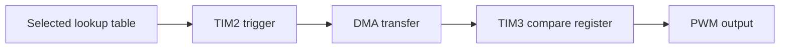
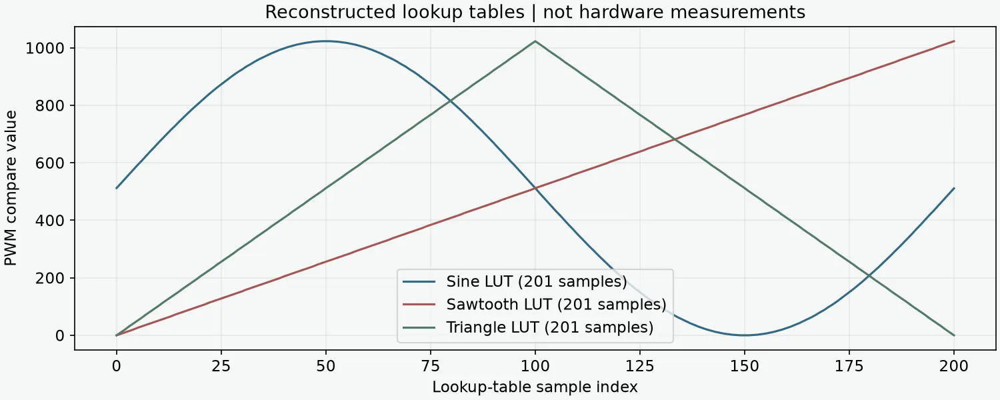

# STM32 Signal Generation: Engineering Case Study

Documentation of collaborative UCT EEE3096S embedded practicals, 2023.

Live interactive portfolio visualisation: [STM32 signal desk](https://azharabdool.vercel.app/playground/stm32/). This is a new browser explanation of source-derived ADC/CCR/PWM mappings, not firmware execution or hardware measurement.

## Overview

Coordinate STM32F0 timers, DMA, waveform tables and PWM output, with related ADC/LCD/GPIO work. This PUBLIC repository contains documentation only. Complete group firmware stays private pending partner permission and vendor/toolchain review.

## Technical Approach

The retained source configures a timer-triggered DMA path that transfers lookup-table values into a PWM compare register. Separate sine, sawtooth and triangle tables support waveform selection. Related practicals poll ADC input and update PWM behaviour.

## Tech Stack

Original work: embedded C, STM32F0 HAL/LL/CMSIS, timers, DMA, ADC, PWM and LCD. This repository is not flashable firmware.

## Key Features

Source-backed peripheral workflow explanation, lookup-table visualisation and honest hardware/build limitations.

## Architecture / Pipeline

## Results

The visual reconstructs the actual table samples from source. No hardware measurements, verified signal accuracy or fresh board execution are claimed. Missing startup/linker, HAL, main.h and LCD support files prevent an independent firmware build from the curated excerpts.

## Running the Project

Read this case study. Reproduction requires the original board project, board-specific dependencies and physical hardware; none is simulated here as a completed run.

## Project Structure

`README.md`: case study; `images/lookup-tables.webp`: source-derived documentation figure. No shared firmware source is published.

## What I Learned

Peripheral timing, DMA transfers, hardware/software interfacing and board-dependent integration. The hand-in identifies two contributors; individual task allocation is not established and sole authorship is not claimed.

## Possible Improvements

Recover the complete original project, validate lookup-table formatting and capture new oscilloscope measurements with explicit test conditions.

## Portfolio Cleanup / Post-project Improvements

Authored diagram and source-derived plot added in 2026. The documentation is new presentation of genuine collaborative work, not a new firmware implementation.
